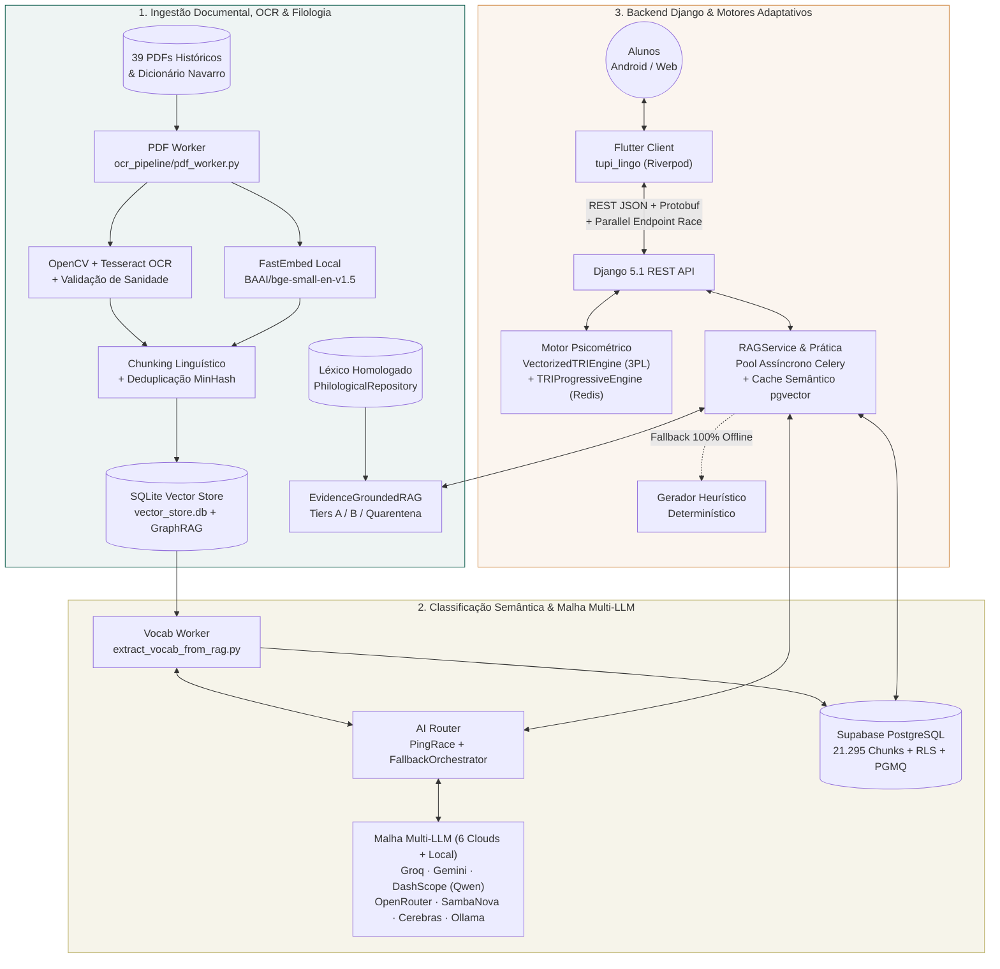
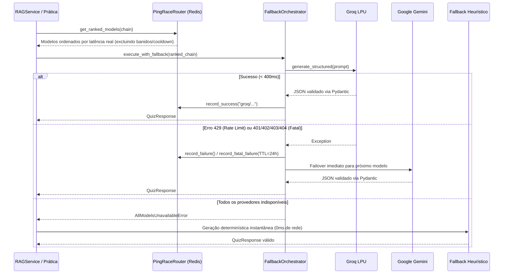
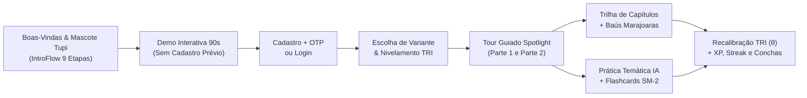
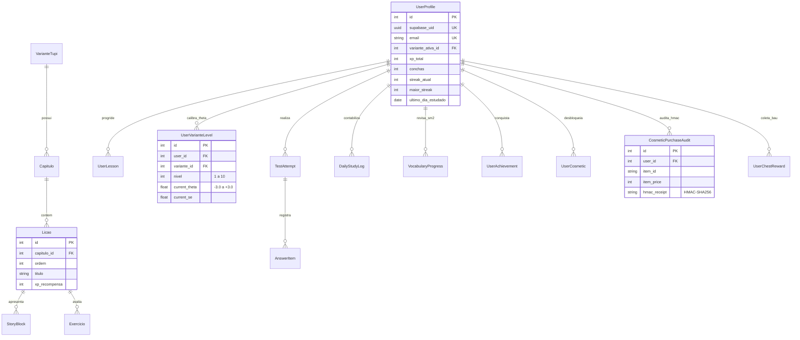

<div align="center">

<svg width="100%" height="220" viewBox="0 0 1200 220" xmlns="http://www.w3.org/2000/svg" role="img" aria-label="TupiLingo Banner">
  <defs>
    <linearGradient id="bgGrad" x1="0%" y1="0%" x2="100%" y2="100%">
      <stop offset="0%" stop-color="#0E5D4E"/>
      <stop offset="55%" stop-color="#14532D"/>
      <stop offset="100%" stop-color="#B8AF64"/>
    </linearGradient>
    <pattern id="dots" width="26" height="26" patternUnits="userSpaceOnUse">
      <circle cx="2" cy="2" r="1.4" fill="#F3F2E8" opacity="0.18"/>
    </pattern>
  </defs>
  <rect width="1200" height="220" rx="18" fill="url(#bgGrad)"/>
  <rect width="1200" height="220" rx="18" fill="url(#dots)"/>
  <g transform="translate(60,58)">
    <text x="0" y="0" font-family="Helvetica, Arial, sans-serif" font-size="56" font-weight="700" fill="#F3F2E8">TupiLingo</text>
    <text x="0" y="42" font-family="Helvetica, Arial, sans-serif" font-size="20" fill="#F3F2E8" opacity="0.92">Plataforma de IA Adaptativa para Salvaguarda, Ensino e Revitalização do Tupi Antigo</text>
    <text x="0" y="74" font-family="Helvetica, Arial, sans-serif" font-size="15" fill="#D08A45">Rigor Filológico (Navarro, 2013) · RAG Fundamentado em Evidências · Orquestração Multi-LLM · TRI 3PL Progressivo</text>
  </g>
  <g transform="translate(980,40)" opacity="0.9">
    <circle cx="0" cy="0" r="46" fill="none" stroke="#F3F2E8" stroke-width="2" opacity="0.5"/>
    <circle cx="0" cy="0" r="30" fill="none" stroke="#D08A45" stroke-width="2" opacity="0.8"/>
    <circle cx="0" cy="0" r="14" fill="#F3F2E8" opacity="0.9"/>
  </g>
</svg>

# TupiLingo

**Plataforma educacional e científica aberta para o ensino estruturado, preservação e revitalização do Tupi Antigo Clássico (séc. XVI–XVII) e do Tupi Antigo Revitalizado, impulsionada por Psicometria Adaptativa (TRI 3PL), RAG Filológico Fundamentado em Evidências e Orquestração Multi-LLM Resiliente.**

<br/>

[](#09--arquitetura-flutter-mobile--web)
[](#09--arquitetura-flutter-mobile--web)
[](#08--arquitetura-do-backend-django)
[](#08--arquitetura-do-backend-django)

[](#17--arquitetura-de-banco-de-dados--supabase)
[](#17--arquitetura-de-banco-de-dados--supabase)
[](#06--pipeline-rag-filológico--ocr)
[](#20--engenharia-de-performance)

[](#05--infraestrutura-de-ia--malha-multi-provedor)
[](#05--infraestrutura-de-ia--malha-multi-provedor)
[](#05--infraestrutura-de-ia--malha-multi-provedor)
[](#06--pipeline-rag-filológico--ocr)
[](#07--motor-psicométrico-adaptativo-tri-3pl--srs-sm-2)

[](#15--infraestrutura-docker)
[](#05--infraestrutura-de-ia--malha-multi-provedor)
[](#08--arquitetura-do-backend-django)
[](#19--observabilidade--console-sre-in-app)
[](#19--observabilidade--console-sre-in-app)

[](#25--licença--créditos-acadêmicos)
[](#04--arquitetura-ponta-a-ponta)
[](#01--visão--rigor-filológico)
[](#05--infraestrutura-de-ia--malha-multi-provedor)
[](#09--arquitetura-flutter-mobile--web)

<br/>

[](https://felipeamlozano-ui.github.io/TupiLingo-Project/app/)
[](https://github.com/felipeamlozano-ui/TupiLingo-Project/releases/download/v1.0.0-preview/app-release.apk)
[](https://felipeamlozano-ui.github.io/TupiLingo-Project/)

</div>

<br/>

<div align="center">
<sub>Construído para preservar e democratizar o acesso a um dos maiores patrimônios linguísticos e históricos do Brasil — unindo engenharia de sistemas distribuídos, inteligência artificial aplicada e rigor filológico.</sub>
</div>

<br/>

---

## Sumário

| # | Seção |
|---|---|
| 01 | [Visão & Rigor Filológico](#01--visão--rigor-filológico) |
| 02 | [Por que o TupiLingo?](#02--por-que-o-tupilingo) |
| 03 | [Diagnóstico Completo do Projeto (O que Tem vs. O que é Futuro)](#03--diagnóstico-completo-do-projeto-o-que-tem-vs-o-que-é-futuro) |
| 04 | [Arquitetura Ponta a Ponta](#04--arquitetura-ponta-a-ponta) |
| 05 | [Infraestrutura de IA & Malha Multi-Provedor](#05--infraestrutura-de-ia--malha-multi-provedor) |
| 06 | [Pipeline RAG Filológico & OCR](#06--pipeline-rag-filológico--ocr) |
| 07 | [Motor Psicométrico Adaptativo (TRI 3PL & SRS SM-2)](#07--motor-psicométrico-adaptativo-tri-3pl--srs-sm-2) |
| 08 | [Arquitetura do Backend (Django)](#08--arquitetura-do-backend-django) |
| 09 | [Arquitetura Flutter (Mobile & Web)](#09--arquitetura-flutter-mobile--web) |
| 10 | [Design System & Economia Gamificada (Loja de Conchas)](#10--design-system--economia-gamificada-loja-de-conchas) |
| 11 | [Experiência de Aprendizado e Fluxos do Aluno](#11--experiência-de-aprendizado-e-fluxos-do-aluno) |
| 12 | [Landing Page Oficial & Deploy Web](#12--landing-page-oficial--deploy-web) |
| 13 | [Estrutura Real do Repositório](#13--estrutura-real-do-repositório) |
| 14 | [Ambiente de Desenvolvimento](#14--ambiente-de-desenvolvimento) |
| 15 | [Infraestrutura Docker](#15--infraestrutura-docker) |
| 16 | [Documentação Completa da API (`/api/v1/`)](#16--documentação-completa-da-api-apiv1) |
| 17 | [Arquitetura de Banco de Dados & Supabase](#17--arquitetura-de-banco-de-dados--supabase) |
| 18 | [Segurança Forense, Criptografia & Hardening RLS](#18--segurança-forense-criptografia--hardening-rls) |
| 19 | [Observabilidade & Console SRE In-App](#19--observabilidade--console-sre-in-app) |
| 20 | [Engenharia de Performance](#20--engenharia-de-performance) |
| 21 | [Estratégia de Testes & Benchmarks Filológicos](#21--estratégia-de-testes--benchmarks-filológicos) |
| 22 | [Pipeline de CI/CD](#22--pipeline-de-cicd) |
| 23 | [Roadmap & Features Futuras (Mapa Interativo de Pindorama)](#23--roadmap--features-futuras-mapa-interativo-de-pindorama) |
| 24 | [Como Contribuir](#24--como-contribuir) |
| 25 | [Licença & Créditos Acadêmicos](#25--licença--créditos-acadêmicos) |
| 26 | [Política de Gestão de Mídias & Repositório Limpo](#26--política-de-gestão-de-mídias--repositório-limpo) |

---

## 01 · Visão & Rigor Filológico

> O **TupiLingo** nasce na interseção entre três disciplinas que raramente se encontram em sistemas de produção: **filologia documental tupinológica**, **engenharia de sistemas distribuídos de IA** e **psicometria computacional**.

### Missão
Preservar e democratizar o aprendizado da língua matriz da história brasileira — em suas vertentes **Tupi Antigo (Língua Clássica da Costa, séc. XVI–XVII)** e **Tupi Antigo Revitalizado** — por meio de uma plataforma gamificada, gratuita, cientificamente rigorosa e resiliente a falhas de conectividade ou provedores em nuvem.

### Fundamentação Filológica Canônica
Todo o conteúdo pedagógico, léxico e gramatical do projeto passou por **saneamento filológico estrito** (`saneamento_filologico_navarro.py` e `audit_navarro_dictionary_full.py`) fundamentado nas obras de referência:
- **Prof. Dr. Eduardo de Almeida Navarro (USP):** *Dicionário de Tupi Antigo: A Língua Indígena Clássica do Brasil* (Global Editora, 2013) e *Método Moderno de Tupi Antigo* (1998/2005).
- **Pe. José de Anchieta:** *Arte de Gramática da Língua mais Usada na Costa do Brasil* (1595).
- **Pe. Luís Figueira:** *Arte da Língua Brasílica* (1621).

### Princípios de Engenharia e Filologia

| Princípio | Implementação Real no Código |
|---|---|
| **Zero Alucinação Lexical** | O motor `EvidenceGroundedRAG` (`pedagogico/filologia/rag_engine.py`) proíbe inferência conjectural: se um lema não consta nas fontes homologadas, o sistema emite **Declaração Mandatória de Incerteza** e coloca candidatos não revisados em quarentena (`PhilologicalStatus.QUARENTENA`). |
| **Pureza de Variantes** | Separação estrita entre **Tupi Antigo Clássico** e **Tupi Antigo Revitalizado**, expurgando nheengatismos indevidos (como *puranga* no lugar de *katu* ou *tuxaua* no lugar de *morubixaba*) e construções macarrônicas. |
| **Resiliência Determinística** | Todo caminho crítico de IA (`rag_service.py`, `views_pratica.py`) possui fallback imediato para um **Gerador Heurístico Determinístico** (`heuristica_service.py`), garantindo **100% de uptime** mesmo sem internet ou cotas de LLM. |
| **Psicometria em Tempo Real** | Calibração contínua da habilidade do aluno ($\theta$) via **Teoria de Resposta ao Item (TRI 3PL)** vetorizada em NumPy (`tri_engine_vectorized.py`) e sessões progressivas sub-milissegundo no Redis (`tri_progressive_service.py`). |
| **Offline-First & Criptografia** | Lições concluídas sem internet são armazenadas localmente no `LessonOutboxService` com assinatura `HMAC-SHA256` + nonce anti-replay (`CryptoEngine` / `store_crypto.py`) e sincronizadas quando a rede retorna. |

---

## 02 · Por que o TupiLingo?

Aplicativos tradicionais de idiomas são projetados para línguas comerciais de altíssima disponibilidade de dados (inglês, espanhol, francês). O Tupi Antigo enfrenta desafios estruturais opostos:

1. **Escassez de Corpus Digital Limpo:** As fontes primárias existem majoritariamente em gramáticas quinhentistas/seiscentistas e dicionários acadêmicos densos, exigindo um pipeline próprio de OCR com pré-processamento em OpenCV (`ocr_pipeline/pdf_worker.py`) e validação heurística de sanidade.
2. **Risco de Alucinação em LLMs Genéricos:** Modelos de linguagem comerciais frequentemente misturam Tupi Antigo, Guarani Paraguaio e Nheengatu Amazônico, inventando palavras inexistentes. O TupiLingo resolve isso ancorando os LLMs em um grafo e repositório filológico verificado, usando a IA apenas para redação pedagógica de enunciados e geração controlada de distratores.
3. **Instabilidade de Provedores de IA Gratuitos/Low-Cost:** Para manter a iniciativa aberta e sustentável, o backend implementa uma malha de **6 provedores cloud + Ollama local** com corrida de latência (*Ping Race*) e Circuit Breaker distribuído.

---

## 03 · Diagnóstico Completo do Projeto (O que Tem vs. O que é Futuro)

Esta tabela reflete a auditoria exata do código-fonte atual (`backend/`, `frontend/tupi_lingo/`, `landing-page/`, `supabase/`), separando com total transparência o que está **100% ativo em produção** do que foi **descontinuado ou movido para o Roadmap Futuro**.

### ✅ O que o Projeto TEM Ativo Hoje

| Domínio | Funcionalidade Ativa | Localização no Código |
|---|---|---|
| **Variantes Linguísticas** | **2 Variantes Homologadas:** **Tupi Antigo** (`tupi_antigo`, 20 capítulos, 80 lições) e **Tupi Antigo Revitalizado** (`tupi_revitalizado`, 20 capítulos, 80 lições) — totalizando **40 capítulos**, **160 lições**, **320 StoryBlocks**, **344 itens de vocabulário** e **486 exercícios**. | `backend/trilha/models.py`, `backend/pedagogico/` |
| **Onboarding & Demo 90s** | Fluxo imersivo em **9 etapas** com o **Mascote Tupi** (estados animados de humor), palavras Tupi do cotidiano, escolha de motivação, meta diária e **lição demonstrativa interativa** antes mesmo do cadastro. | `lib/features/onboarding/presentation/intro_flow_screen.dart` |
| **Tour Guiado (Spotlight)** | Tutorial interativo em 2 partes destacando o banner do capítulo, primeiro nó da trilha, seletor de variante, ofensiva, conchas, XP e barra de navegação (reexecutável nos Ajustes). | `lib/features/onboarding/presentation/tour/tour_controller.dart` |
| **Aba 1: Trilha Serpenteante** | Caminho vertical com botões 3D táteis, seletor horizontal de capítulos, **Guia Cultural e Gramatical** por capítulo, **Baús de Artefatos Indígenas** com partículas Marajoaras e **monitor térmico** (pausa GPU após 8s ocioso). | `lib/features/home/presentation/tabs/trail_tab_view.dart`, `trail_canvas_view.dart` |
| **Player de Lições & Validação** | StoryBlocks narrativos + exercícios de **Múltipla Escolha**, **Completar Lacunas (tokens clicáveis)** e **Associação de Colunas**, com validação fuzzy (`unaccent` + Levenshtein + trigramas `pg_trgm`). | `lib/features/lesson/`, `backend/users/services/validation_service.py` |
| **Aba 1: Trilha de Capítulos (40 Módulos)** | **20 capítulos completos para Tupi Antigo** + **20 capítulos completos para Tupi Revitalizado** (total de 40 módulos), totalizando **487 exercícios** e **1.879 versões ativas** calibradas com derangement estrito nas associações e zero clichês. | `backend/pedagogico/conteudo/`, `lib/features/trail/` |
| **Aba 2: Prática Contextualizada** | **6 temas predefinidos** (*Natureza e Rios*, *Animais e Caça*, *Mitologia e Tupã*, *Aldeia e Cotidiano*, *Guerra e Rituais*, *Culinária e Roça*) + **Tema Livre via IA** + **Flashcards de Revisão Espaçada (SM-2)** com banco de vocabulário desbloqueado por capítulo. | `lib/features/home/presentation/tabs/practice_tab_view.dart`, `lib/features/pratica/` |
| **Nivelamento & TRI 3PL** | Teste adaptativo por variante (`TesteScreen`), cálculo vetorizado MAP/EAP (`VectorizedTRIEngine`), **TRI Progressivo em Tempo Real** (< 1ms no Redis com detecção matemática de chute) e **Calibrador NLP Zero-Shot** (`NLPItemCalibrator`). | `backend/nivelamento/services/`, `lib/features/assessment/presentation/teste.dart` |
| **Aba 3: Perfil & Analytics** | Medidor psicométrico (`NivelGauge`), Radar de Maestria (`MasteryRadarChart`), Gráfico 3D de XP (`Progress3DBarChart`), Ofensiva (`StreakCard`), Galeria de **46 Conquistas (`AchievementGallery`)** e histórico de lições. | `lib/features/profile/`, `lib/features/dashboard/` |
| **Loja de Conchas (Cosméticos)** | Economia gamificada com compra e ativação auditada por `HMAC-SHA256`: **4 Temas Visuais** (*Floresta de Jade*, *Areia Sagrada*, *Noite Estrelada de Tupã*, *Chama da Caapora*), **5 Avatares**, **Molduras** e **Lições Especiais**. | `lib/features/store/`, `backend/users/views_store.py`, `store_catalog.py` |
| **Aba 4: Ajustes & Autodescoberta** | Efeitos sonoros, notificações locais, temas, termos legais (`TermsOfUseScreen`) e **Parallel Endpoint Race** (corrida automática entre cache, túnel Cloudflare via Supabase Storage e IP local). | `lib/features/settings/`, `lib/main.dart` |
| **Aba 5: Console Admin & SRE** | Gestão CRUD in-app de Capítulos, Lições e Exercícios + **Platform & Security Suite** protegida por OTP Enclave (`LiveOps`, `Observatory`, `Feature Flags`, `Crash Intel`, `Zero-Leak AES-GCM Logs`, `SOC Audit Trail SHA-256`). | `lib/features/admin/`, `backend/platform_telemetry/` |
| **Malha Multi-LLM & RAG** | Roteador inteligente com **PingRace + Circuit Breaker** (Groq, Gemini, DashScope/Qwen, OpenRouter, SambaNova, Cerebras, Ollama) + **21.295 chunks** no Supabase + `vector_store.db` SQLite + `EvidenceGroundedRAG`. | `backend/app/ai/`, `backend/pedagogico/filologia/` |

### 🔮 O que NÃO Está Ativo na Interface Atual (Movido para Features Futuras / Removido)

| Item | Status Atual no Repositório | Motivo / Destino |
|---|---|---|
| **Mapa Histórico Interativo de Pindorama (2D/3D)** | **Feature Futura (Desativado na UI e nas URLs)** | Os modelos (`backend/world_builder/`) e shaders existem como fundação técnica, mas a rota `/api/v1/world/` está comentada em `config/urls.py` e a navegação principal foi simplificada para a **Trilha de Capítulos**. Previsto no **Roadmap v2.0**. |
| **Motor Nativo Rust / WebGPU (`tupi_wgpu_engine`)** | **Protótipo Experimental (Futuro)** | Localizado em `native/tupi_wgpu_engine/` para futura renderização gráfica de alta performance do Mapa de Pindorama; não é exigido na compilação padrão atual. |
| **Trilhas Isoladas de *Tupinambá* e *Kamaiurá*** | **Expurgadas no Saneamento Filológico** | Removidas pelo script `saneamento_filologico_navarro.py` para evitar contaminação entre troncos/famílias distintas e concentrar 100% do rigor documental no **Tupi Antigo** e **Tupi Antigo Revitalizado**. Novas línguas Tupi-Guarani entrarão no Roadmap com curadoria dedicada. |
| **Reconhecimento de Voz (Pronúncia via Microfone)** | **Planejado (Roadmap)** | Modelos de áudio (`whisper-large-v3-turbo`) já estão mapeados e segregados em `router.py`, mas a captura de voz pelo aluno ainda não faz parte do player de exercícios atual. |

---

## 04 · Arquitetura Ponta a Ponta

O diagrama abaixo descreve o fluxo completo desde a ingestão documental e saneamento filológico até a entrega de lições e práticas adaptativas no cliente Flutter (Mobile e Web).



---

## 05 · Infraestrutura de IA & Malha Multi-Provedor

O TupiLingo opera uma camada própria de roteamento e resiliência em `backend/app/ai/` (`router.py`, `ping_race.py`, `fallback.py`, `invoker.py`) que abstrai **6 provedores em nuvem** e **1 provedor local offline**.

### Catálogo de Provedores e Especialidades (`router.py`)

| Provedor | Modelos Integrados | Papel Arquitetural |
|---|---|---|
| **Groq Cloud (LPU)** | `openai/gpt-oss-120b`, `openai/gpt-oss-20b`, `qwen/qwen3.8-27b`, `allam-2-7b`, `openai/gpt-oss-safeguard-20b` | **Topo da cadeia `_CHAIN_FAST` (~200–400ms):** inferência de baixíssima latência para prática temática e extração de vocabulário. |
| **Google Gemini** | `gemini-2.5-flash`, `gemini-3.6-flash`, `gemini-2.5-flash-lite` | Inferência estruturada rápida, janelas de contexto longas (`_CHAIN_LONG_CONTEXT` > 30k tokens) e alta estabilidade. |
| **Alibaba Cloud (DashScope)** | `qwen-max`, `qwen3.7-max`, `qwen3.8-max`, `qwen-plus`, `qwen3.6-plus`, `qwen-turbo`, `qwen-coder-plus` | Especialistas em validação psicométrica, saídas JSON estruturadas e geração profunda de quizzes. |
| **SambaNova Cloud** | `DeepSeek-V3.2`, `DeepSeek-V3.1`, `Meta-Llama-3.3-70B-Instruct`, `MiniMax-M3`, `gemma-4-31B-it` | Aceleração em hardware dedicado para failover de raciocínio e geração de distratores. |
| **Cerebras Cloud** | `qwen-3.8-27b`, `gpt-oss-120b` | Alta taxa de tokens/segundo (contexto de 131k, 450 RPM) na cadeia rápida. |
| **OpenRouter (Free Tiers)** | `google/gemma-4-31b-it:free`, `google/gemma-4-26b-a4b-it:free`, `poolside/laguna-xs-2.1:free`, `cohere/north-mini-code:free`, `minimax/minimax-m3:free`, `nvidia/nemotron-3-super-120b-a12b:free` | Camada de contingência custo-zero para absorver picos de carga sem custo adicional. |
| **Ollama (Local Offline)** | `qwen2.5:1.5b-instruct`, `qwen2.5:1.5b`, `llama3.2:1b` | Cadeia `_CHAIN_LOCAL_ONLY` para execução 100% desconectada da internet. |

> **Isolamento Estrito de Modelos Auxiliares:** Modelos de guarda/moderação (`meta-llama/llama-prompt-guard-2-86m`), áudio (`whisper-large-v3-turbo`, `canopylabs/orpheus-v1`) e embeddings/rerankers (`nvidia/llama-nemotron-rerank-vl-1b-v2:free`) ficam segregados em catálogos dedicados para jamais contaminarem as filas de geração textual.

### PingRaceRouter & Circuit Breaker Distribuído (`ping_race.py`)



- **Banimento Automático de Erros Fatais (`record_fatal_failure`):** Erros de cota esgotada, chave inválida ou modelo depreciado (`401`, `402`, `403`, `404`) desativam o modelo automaticamente no Redis por **24 horas** (`FATAL_BAN_TTL_SECONDS = 86400`), evitando desperdício de latência em chamadas subsequentes.
- **Cooldown de Erros Transientes (`record_failure`):** Timeouts e erros `429`/`5xx` colocam o provedor em janela curta de resfriamento enquanto o tráfego flui pelos demais provedores.

---

## 06 · Pipeline RAG Filológico & OCR

O sistema combina duas camadas complementares de recuperação de conhecimento:

### 1. Motor RAG Fundamentado em Evidências (`pedagogico/filologia/`)
Construído sobre o repositório filológico homologado (`lexicon_repository.py`), impõe um contrato rigoroso (`RAGResponseContract`) com **4 níveis de prioridade**:
1. **`EXACT_LEMMA` (Confiança 1.0 · `TIER_A_TRANSCRICAO_LITERAL`):** Correspondência exata com o lema documental de Navarro (2013).
2. **`NORMALIZED_LEMMA` (Confiança 0.95 · `TIER_B_NORMALIZACAO_PESQUISA`):** Busca normalizada (remoção controlada de diacríticos via `normalize_tupi`) preservando a nota ortográfica da grafia original.
3. **`DOCUMENTED_VARIANT` (Confiança 0.90 · `TIER_B_NORMALIZACAO_PESQUISA`):** Variantes dialetais ou históricas explicitamente remissivas no dicionário.
4. **`NO_EVIDENCE_DECLARED` (Confiança 0.0 · `TIER_E_HIPOTESE_NAO_VERIFICADA`):** Declaração explícita de ausência documental — o sistema se recusa a inventar traduções ou promover similaridade vetorial isolada a gabarito oficial.

### 2. Pipeline OCR Industrial & GraphRAG Híbrido (`ocr_pipeline/pdf_worker.py` & `rag_service.py`)
- **Renderização e Pré-processamento:** Renderiza páginas a **300 DPI** via `pypdfium2`, corrige orientação com `OpenCV`, aplica binarização adaptativa/denoising e extrai texto com score de confiança por palavra via `pytesseract`.
- **Filtro Anti-Ruído & Deduplicação:** `validar_sanidade_chunk` descarta páginas corrompidas e `compute_shingles` (Jaccard / MinHash) elimina quase-duplicatas.
- **Busca Híbrida Ponderada por Autoridade (`source_authority_weight`):** Combina busca vetorial (`FastEmbed` + `SQLiteVectorDB` / `pgvector`), ranking lexical `BM25` (`rank_bm25`) e subgrafos de coocorrência (`KnowledgeGraphService` em `NetworkX`), atribuindo peso máximo (`1.5x`) às obras canônicas de Navarro e Anchieta.

---

## 07 · Motor Psicométrico Adaptativo (TRI 3PL & SRS SM-2)

### 1. Teoria de Resposta ao Item — Modelo Logístico de 3 Parâmetros (3PL)
Em vez de listas estáticas, a proficiência latente $\theta \in [-3.0, +3.0]$ do aluno é calculada para cada variante linguística usando o modelo 3PL vetorizado (`tri_engine_vectorized.py`):

$$P_i(\theta) = c_i + \frac{1 - c_i}{1 + e^{-D \cdot a_i (\theta - b_i)}}$$

Onde $D = 1.702$ é a constante de escala normal, e cada exercício possui:
- **$a_i$ (Discriminação):** Capacidade do item de diferenciar alunos de níveis próximos.
- **$b_i$ (Dificuldade):** Localização do item na régua psicométrica $[-3.0, +3.0]$.
- **$c_i$ (Acerto Casual / Guessing):** Probabilidade piso de acerto por chute.

A seleção do próximo item maximiza a **Informação de Fisher**:

$$I_i(\theta) = D^2 a_i^2 \frac{(P_i(\theta) - c_i)^2}{(1 - c_i)^2} \frac{1 - P_i(\theta)}{P_i(\theta)}$$

### 2. Calibrador NLP Zero-Shot (`nlp_item_calibrator.py`)
Para eliminar o problema de *Cold-Start* em novas questões geradas via RAG, o `NLPItemCalibrator` infere analiticamente os parâmetros $(a, b, c)$ antes mesmo de haver histórico humano:
- **Inferência de Dificuldade ($b$):** Avalia densidade léxica, subordinações sintáticas e **marcadores morfológicos complexos do Tupi Antigo** (nasalizações `~`, `mb`, `nd`, `ng`; prefixos relacionais `r-`, `s-`, `t-`; prefixos número-pessoais `a-`, `ere-`, `o-`, `oro-`, `îa-`, `pe-`; sufixos nominalizadores `-ba'e`, `-paba`, `-saba`, `-rama`; e oclusivas glotais `'`).
- **Inferência de Chute ($c$) e Discriminação ($a$):** Calcula a similaridade de cosseno entre os embeddings leves da resposta correta e dos distratores (distratores semanticamente próximos reduzem a facilidade de eliminação superficial).

### 3. TRI Progressivo em Tempo Real & Anti-Chute (`tri_progressive_service.py` — RFC v3.2)
Durante sessões de Prática Temática:
- Cada resposta atualiza o estado da sessão no Redis (`tri_session:<id>`) em **< 1ms**.
- **Detector Matemático de Chute (`detectar_chute_matematico`):** Cruza a probabilidade $P_i(\theta)$ com a latência cognitiva (`time_taken_seconds`). Respostas dadas em tempo incompatível com a leitura em itens de alta dificuldade são flagadas como chute, protegendo o $\theta$ contra inflação artificial e ajustando a recompensa de XP/Conchas.

### 4. Repetição Espaçada SM-2 (`VocabularyProgress` & `srs_service.py`)
Cada vocábulo estudado possui agendamento individual baseado no algoritmo **SuperMemo-2** (`repetitions`, `ease_factor`, `interval_days`, `next_review`), priorizando automaticamente as palavras com menor taxa de retenção na aba de Prática e nos Flashcards.

---

## 08 · Arquitetura do Backend (Django)

O backend (`backend/`) é construído em **Django 5.1** e **Python 3.13+**, estruturado em módulos de domínio coesos:

```
backend/
├── app/
│   ├── ai/                     # Malha Multi-LLM (router, ping_race, fallback, rag_service, knowledge_graph)
│   │   └── providers/          # Adaptadores: groq, gemini, dashscope, sambanova, cerebras, openai, ollama
│   ├── core/                   # Settings Pydantic, FriendlyExceptionMiddleware, OpenTelemetry
│   ├── infra/                  # Configuração Celery e workers assíncronos (replenish_quiz_pool_task)
│   ├── schemas/                # Contratos Pydantic (QuizItem, EsqueletoItem, ExtractedTerm)
│   └── services/               # SupabaseService (connection pool HTTPX + RPCs) e VaultService
├── config/                     # Settings Django divididos (base.py, development.py, production.py) e URLs
├── nivelamento/                # Avaliação diagnóstica, VectorizedTRIEngine, TRIProgressiveEngine, NLPItemCalibrator
├── ocr_pipeline/               # pdf_worker.py (300 DPI, OpenCV, Tesseract, MinHash, FastEmbed)
├── pedagogico/                 # Currículo canônico, lexicon_data.py e motor filológico (filologia/)
├── platform_telemetry/         # Observabilidade SRE, FeatureFlags, AuditLog SHA-256, CrashCluster, OTP Enclave
├── proto_gen/                  # Classes Python geradas do Protocol Buffers (tupilingo_pb2.py)
├── scripts/                    # Auditoria filológica Navarro, importação pedagógica, benchmarks SLO e Proto
├── trilha/                     # VarianteTupi, Capitulo, Licao, StoryBlock, Exercicio, UserChestReward, Prática
├── users/                      # UserProfile, UserLesson, Achievement, DailyStudyLog, Loja de Conchas, Validação Fuzzy
└── world_builder/              # Modelos de território/épocas (reservados para a Feature Futura do Mapa Pindorama)
```

---

## 09 · Arquitetura Flutter (Mobile & Web)

O aplicativo multiplataforma (`frontend/tupi_lingo/`) utiliza **Flutter 3.44 / Dart 3.12+** com **Riverpod**, **Clean Architecture** por feature e suporte nativo a **Android** e **Web (GitHub Pages SPA)**:

```
frontend/tupi_lingo/lib/
├── core/
│   ├── algorithms/             # QuadTree espacial
│   ├── audio/                  # AudioManager (efeitos táteis, acerto, erro, baú)
│   ├── config/                 # AppConfig + autodescoberta de backend / túnel Cloudflare
│   ├── logging/                # AppLogger com logs criptografados (EncryptedLogEntry)
│   ├── network/                # ApiClient, ApiCacheManager (Frame-0 cache), LessonOutboxService, PinnedHttpClient
│   ├── notifications/          # NotificationService (lembretes locais de ofensiva)
│   ├── proto/                  # Contratos binários Protobuf (tupilingo.pb.dart)
│   ├── security/               # CryptoEngine (AES-GCM + HMAC-SHA256), SessionManager, SecurityGuard, DeveloperEnclaveSession
│   ├── telemetry/              # TelemetryService (monitoramento de FPS, frame timing e memória)
│   ├── theme/                  # AppTheme (modo claro/escuro + 4 temas cosméticos da loja)
│   └── widgets/                # Componentes globais: TupiButton, TupiCard, UserAvatarWidget, Badges
└── features/
    ├── adaptive_leveling/      # Rastreador cognitivo e planejador de dificuldade
    ├── adaptive_srs/           # Agendador contextual de revisão espaçada
    ├── admin/                  # AdminScreen (CRUD Trilha) + PlatformSuiteShell (Developer & Security Console)
    ├── assessment/             # TesteScreen (nivelamento inicial adaptativo por variante)
    ├── auth/                   # Login, Cadastro multi-etapas, Verificação OTP e Recuperação de Senha
    ├── curriculum/             # Grafo de pré-requisitos e objetivos pedagógicos
    ├── dashboard/              # ProgressDashboardScreen, MasteryRadarChart, Progress3DBarChart
    ├── feature_flags/          # Controle dinâmico de flags remotas/locais
    ├── home/                   # HomeScreen, TrailTabView, PracticeTabView, TrailCanvasView, Guia Cultural
    ├── knowledge_graph/        # Extração e travessia de subgrafos semânticos v2
    ├── legal/                  # Consentimento LGPD, Termos de Uso e Declaração de Salvaguarda Linguística
    ├── lesson/                 # LessonPlayerScreen (StoryBlocks, Múltipla Escolha, Lacunas, Associação)
    ├── linguistic_morphology/  # Parser morfológico Tupi, decomposição de afixos e validador
    ├── phonology/              # Conversor fonético IPA e similaridade fonológica
    ├── pratica/                # ThematicPracticeScreen + ThematicOutboxService
    ├── profile/                # ProfileScreen, NivelGauge, AchievementGallery, StreakCard
    ├── rewards/                # IndigenousArtifactChest + sistema de partículas Marajoara
    ├── semantic_search/        # Motor de busca lexical com Trie autocomplete e ranking
    ├── settings/               # SettingsScreen (áudio, temas, tour, servidor API)
    └── store/                  # StoreScreen e StoreService (Loja de Conchas auditada)
```

---

## 10 · Design System & Economia Gamificada (Loja de Conchas)

### Identidade Visual Ancestral
A paleta de cores e a tipografia (`Nunito`, `Plus Jakarta Sans` e `JetBrains Mono`) foram desenhadas para evocar a floresta tropical, a cerâmica marajoara e os pigmentos naturais (urucum e jenipapo):

| Token | Hex | Aplicação na Interface |
|---|---|---|
| **Verde Floresta (Primary)** | `#0E5D4E` | Ações principais, cabeçalhos culturais, destaques de proficiência |
| **Laranja Urucum (CTA / Accent)** | `#D08A45` | Botões 3D táteis, indicadores de ofensiva (streak), nós ativos da trilha |
| **Ouro Musgo (Secondary)** | `#B8AF64` | Medalhas, conquistas desbloqueadas, detalhes de baús |
| **Pergaminho Quente (Background)** | `#F3F2E8` | Fundo principal no modo claro, reduzindo fadiga visual na leitura |
| **Noite de Tupã (Dark Surface)** | `#060B15` | Superfície escura profunda para o modo noturno |

### Loja de Conchas (`store_catalog.py` & `StoreScreen`)
Os alunos ganham **Conchas** ao concluir lições, coletar baús de capítulo e realizar práticas temáticas, podendo trocá-las na Loja por cosméticos persistidos no banco e protegidos contra adulteração por recibos `HMAC-SHA256` (`CosmeticPurchaseAudit`):
- **Temas Visuais Completos:** *Floresta de Jade* (padrão), *Areia Sagrada de Pindorama* (40 conchas), *Noite Estrelada de Tupã* (80 conchas) e *Chama Sagrada da Caapora* (120 conchas).
- **Avatares Indígenas & Fauna:** *Arara Canindé*, *Guerreiro Maraká*, *Xamã da Floresta*, *Onça Pintada Mística*, *Tamanduá Guardião*.
- **Molduras de Perfil & Lições Especiais:** Molduras temáticas (*Plumas Reais*, *Cerâmica Marajoara*, *Ouro de Pindorama*) e conteúdos extras desbloqueáveis.

---

## 11 · Experiência de Aprendizado e Fluxos do Aluno



1. **Introdução Imersiva (`IntroFlowScreen`):** O aluno conhece o mascote Tupi, descobre quantas palavras em Tupi já fala no dia a dia (*pipoca, abacaxi, guri, mirim, carioca*), escolhe sua motivação e experimenta imediatamente uma **lição demonstrativa interativa**.
2. **Seleção de Variante e Nivelamento (`TesteScreen`):** O estudante escolhe entre **Tupi Antigo** ou **Tupi Antigo Revitalizado**, podendo iniciar do zero (Nível 1) ou realizar o teste adaptativo TRI para ser posicionado automaticamente no nível correspondente (1 a 10).
3. **Navegação Principal em 4 Abas (+ Admin):**
   - **Trilha:** 20 capítulos progressivos por variante, cada um com **Guia Cultural e Gramatical**, 4 lições estruturadas e **Baú de Recompensa** ao final.
   - **Prática:** Sessões geradas dinamicamente sobre 6 eixos temáticos culturais ou qualquer tema livre digitado pelo aluno, além de **Flashcards de Revisão Espaçada**.
   - **Perfil:** Painel completo de evolução psicométrica ($\theta$), calendário/ofensiva, gráficos de maestria por categoria, **Loja de Conchas** e galeria de **46 medalhas**.
   - **Ajustes:** Preferências de som, notificações, aparência, repetição do Tour Guiado, diagnóstico de servidor e documentação legal.

---

## 12 · Landing Page Oficial & Deploy Web

O diretório `landing-page/` hospeda a página institucional de divulgação científica e acesso rápido ao ecossistema:
- **Palco 3D Flutuante em Parallax:** Demonstração visual da interface, insígnias de ofensiva e rigor metodológico.
- **Integração Direta com o Flutter Web (`/app/`):** O workflow `.github/workflows/deploy-pages.yml` compila automaticamente o aplicativo Flutter Web em modo release (`--base-href "/TupiLingo-Project/app/"`), injeta o arquivo `.nojekyll` e publica tanto a Landing Page quanto o Web App no GitHub Pages, com roteamento SPA resiliente a recarregamento (`404.html` + estratégia de hash no GitHub Pages).

---

## 13 · Estrutura Real do Repositório

```
TupiLingo/
├── .github/
│   └── workflows/
│       ├── ci.yml                      # Lint (Ruff + MyPy), Pytest, Trivy Security Scan e Build Docker
│       └── deploy-pages.yml            # Build Flutter Web + Deploy automático para GitHub Pages
├── backend/
│   ├── app/                            # Core AI Mesh, RAGService, SupabaseService, Vault, Schemas, Workers
│   ├── config/                         # Settings Django (base, development, production), ASGI/WSGI, URLs
│   ├── docker/                         # Dockerfiles e entrypoints para Django e Workers
│   ├── docs/                           # Relatórios técnicos de pesquisa e migrações RFC
│   ├── nivelamento/                    # Motor TRI 3PL vetorizado, TRI Progressivo e Calibrador NLP
│   ├── ocr_pipeline/                   # Worker de OCR (300 DPI, OpenCV, Tesseract, FastEmbed)
│   ├── pedagogico/                     # Currículo, léxico canônico e motor filológico (Navarro 2013)
│   ├── platform_telemetry/             # Telemetria SRE, Feature Flags, AuditLog SHA-256 e OTP Enclave
│   ├── proto_gen/                      # Contratos Protobuf compilados para Python
│   ├── scripts/                        # Saneamento filológico, auditoria Navarro, seeds e benchmarks
│   ├── trilha/                         # Modelos e views de Variantes, Capítulos, Lições e Prática Temática
│   ├── users/                          # Autenticação, Perfil, Streaks, SRS, Conquistas e Loja de Conchas
│   ├── world_builder/                  # Modelos reservados para a Feature Futura do Mapa de Pindorama
│   ├── docker-compose.yml              # Orquestração base de containers
│   ├── manage.py
│   └── requirements.txt
├── frontend/
│   └── tupi_lingo/
│       ├── lib/                        # Código-fonte Dart/Flutter (18 módulos em features/ + core/)
│       ├── web/                        # Bootstrap web, manifest.json, index.html e 404.html
│       ├── assets/                     # Áudios (.wav), imagens e fragment shaders (.frag)
│       └── pubspec.yaml
├── landing-page/                       # Landing Page estática + subdiretório /app com build Flutter Web
├── native/
│   └── tupi_wgpu_engine/               # Protótipo experimental em Rust/WebGPU (Feature Futura)
├── proto/                              # Definições .proto (Protocol Buffers v3)
├── supabase/
│   └── migrations/                     # 01_quiz_engine.sql até 07_sec_p0_hardening_rls_and_rpc.sql
└── README.md
```

---

## 14 · Ambiente de Desenvolvimento

### Pré-requisitos

| Ferramenta | Versão | Obrigatório |
|---|---|---|
| **Python** | `3.13+` | ✅ |
| **Flutter SDK** | `3.44+` (Dart `>=3.12.0 <4.0.0`) | ✅ |
| **PostgreSQL / Supabase** | PostgreSQL 15+ com `pgvector`, `pg_trgm`, `unaccent` | ✅ |
| **Redis** | `7.x+` (Cache, PingRace e sessões TRI Progressivo) | ⚙️ Recomendado (possui fallback em memória local) |
| **Docker & Docker Compose** | Última versão estável | ⚙️ Opcional |

### 1. Clonar o Repositório

```bash
git clone https://github.com/felipeamlozano-ui/TupiLingo-Project.git
cd TupiLingo-Project
```

### 2. Configurar e Executar o Backend (Django)

```bash
cd backend
python -m venv venv
# Windows (PowerShell):
.\venv\Scripts\Activate.ps1
# Linux / macOS:
source venv/bin/activate

pip install -r requirements.txt
python manage.py migrate
python manage.py runserver 0.0.0.0:8000
```

### 3. Configurar e Executar o Frontend (Flutter)

```bash
cd frontend/tupi_lingo
flutter pub get

# Executar no Chrome (Web) ou dispositivo Android conectado:
flutter run -d chrome
# Build para GitHub Pages:
flutter build web --release --base-href "/TupiLingo-Project/app/"
```

### 4. Scripts Filológicos e de Manutenção

```bash
# Saneamento filológico completo segundo Navarro (2013):
python backend/scripts/saneamento_filologico_navarro.py

# Importação completa do conteúdo pedagógico para o banco:
python backend/scripts/import_pedagogico_completo.py

# Extração contínua de vocabulário via RAG Worker:
python backend/manage.py extract_vocab_from_rag --continuous
```

---

## 15 · Infraestrutura Docker

A orquestração em `backend/docker-compose.yml` isola os serviços em rede interna (`tupilingo_net`) com cache persistente de modelos HuggingFace/FastEmbed:

| Serviço | Papel |
|---|---|
| `django` | API REST servida via Gunicorn com pool de conexões para o Supabase e Redis. |
| `nginx` | Proxy reverso de borda servindo arquivos estáticos e mídia em modo somente-leitura (`:ro`). |
| `pdf_worker` | Container dedicado (profile `workers`) para OCR e vetorização de PDFs em `/app/pdfs`. |
| `vocab_worker` | Container dedicado (profile `workers`) para classificação semântica assíncrona de chunks. |

---

## 16 · Documentação Completa da API (`/api/v1/`)

Todas as rotas autenticadas exigem o header `Authorization: Bearer <supabase_jwt>`.

### Autenticação, Onboarding & Perfil (`users/urls.py`)

| Método | Endpoint | Descrição |
|---|---|---|
| `POST` | `/api/v1/auth/login` | Autentica usuário via e-mail/senha no Supabase Auth com proteção de rate-limit. |
| `POST` | `/api/v1/auth/register` | Cria conta e dispara código OTP de verificação por e-mail. |
| `POST` | `/api/v1/auth/recover-password` | Inicia fluxo de recuperação de senha via OTP. |
| `POST` | `/api/v1/auth/resend-code` | Reenvia código OTP com controle de cooldown. |
| `POST` | `/api/v1/auth/check-user` | Verifica existência do perfil, variante ativa e se já realizou o nivelamento (`ja_testou`). |
| `POST` | `/api/v1/auth/register-user` | Registra o `UserProfile` no Django após confirmação do OTP. |
| `POST` | `/api/v1/auth/onboarding` | Sincroniza motivação, meta diária (`daily_goal_minutes`) e status do Tour Guiado. |
| `POST` | `/api/v1/auth/update-variante` | Alterna a variante ativa do aluno (`Tupi Antigo` ↔ `Tupi Antigo Revitalizado`). |
| `GET` | `/api/v1/auth/profile` | Retorna perfil completo, nível TRI, ofensiva, conquistas e cosméticos equipados (JSON). |
| `GET` | `/api/v1/auth/profile/proto` | Retorna o perfil serializado em binário **Protocol Buffers** (`application/x-protobuf`). |
| `GET` | `/api/v1/dashboard/stats/` | Estatísticas autênticas de estudo diário, maestria por categoria e histórico semanal. |

### Trilha, Lições & Validação Fuzzy (`trilha/urls.py`)

| Método | Endpoint | Descrição |
|---|---|---|
| `GET` | `/api/v1/trilha/variantes/` | Lista as variantes linguísticas ativas homologadas. |
| `GET` | `/api/v1/trilha/<variante_id>/capitulos/` | Retorna todos os capítulos, lições, status de desbloqueio e baús de recompensa. |
| `GET` | `/api/v1/trilha/licao/<licao_id>/` | Retorna os `StoryBlocks` e os exercícios da lição. |
| `POST` | `/api/v1/trilha/licao/<licao_id>/concluir/` | Conclui a lição (suporta recibo offline `HMAC-SHA256`), recalibra $\theta$ (BirdBrain TRI), atualiza ofensiva e desbloqueia a próxima lição. |
| `POST` | `/api/v1/trilha/capitulo/<cap_id>/bau/<idx>/coletar/` | Coleta baú cultural do capítulo de forma idempotente (+XP e +Conchas). |
| `POST` | `/api/v1/exercicios/verificar/` | Valida resposta aberta/lacuna com normalização Unicode, distância de Levenshtein e trigramas. |

### Prática Temática & TRI Progressivo (`trilha/views_pratica.py`)

| Método | Endpoint | Descrição |
|---|---|---|
| `GET` | `/api/v1/pratica/temas/` | Lista os eixos temáticos disponíveis para prática contextualizada. |
| `POST` | `/api/v1/pratica/gerar-tematico/` | Inicia sessão de prática adaptativa via RAG + Malha Multi-LLM (ou fallback heurístico). |
| `POST` | `/api/v1/pratica/responder-item/` | Atualiza $\theta$ em tempo real (< 1ms no Redis), detecta chute e calcula XP/Conchas do item. |
| `POST` | `/api/v1/pratica/sincronizar-lote/` | Sincroniza em lote respostas de prática realizadas em modo offline. |
| `POST` | `/api/v1/pratica/finalizar/` | Consolida atomicamente os ganhos de XP, Conchas e $\theta$ da sessão no PostgreSQL. |

### Nivelamento Adaptativo (`nivelamento/urls.py`)

| Método | Endpoint | Descrição |
|---|---|---|
| `POST` | `/api/v1/nivelamento/gerar-questao/` | Gera questão adaptativa calibrada para o $\theta$ provisório do aluno na variante. |
| `POST` | `/api/v1/nivelamento/avaliar/` | Executa estimação Bayesiana MAP/EAP 3PL, registra `TestAttempt` e define o nível (1–10). |
| `GET` | `/api/v1/nivelamento/check-variante/` | Verifica se o aluno já possui nivelamento concluído para determinada variante. |
| `POST` | `/api/v1/nivelamento/definir-nivel-inicial/` | Define nível 1 diretamente quando o aluno opta por começar do zero. |

### Loja de Conchas & Console SRE (`users/views_store.py` & `platform_telemetry/urls.py`)

| Método | Endpoint | Descrição |
|---|---|---|
| `GET` | `/api/v1/store/catalog/` | Catálogo de temas, avatares, molduras, saldo de conchas e itens já desbloqueados. |
| `POST` | `/api/v1/store/purchase/` | Compra atômica (`SELECT ... FOR UPDATE`) com geração de recibo `HMAC-SHA256`. |
| `POST` | `/api/v1/store/equip/` | Equipa tema visual, avatar ou moldura no perfil do usuário. |
| `GET` | `/api/v1/platform/overview/` | Visão geral SRE (saúde de serviços, presença online, métricas de FPS/latência, crashes). |
| `POST` | `/api/v1/platform/auth/otp/request/` | Solicita código OTP para abertura do Developer/Security Enclave. |

---

## 17 · Arquitetura de Banco de Dados & Supabase

O sistema utiliza persistência em três camadas: **PostgreSQL no Supabase** (fonte da verdade transacional + `pgvector` + `pg_trgm` + `PGMQ`), **SQLite Local (`vector_store.db`)** (acervo vetorial bruto e grafo de conhecimento) e **Redis** (estado efêmero de sessões TRI, cache de trilhas e PingRace).



---

## 18 · Segurança Forense, Criptografia & Hardening RLS

A segurança foi desenhada em profundidade tanto no banco (migrações `05_enforce_rls_and_security.sql` e `07_sec_p0_hardening_rls_and_rpc.sql`) quanto no cliente Flutter:

| Camada | Controle Implementado |
|---|---|
| **Row Level Security (RLS) Total** | Todas as tabelas públicas do Supabase possuem RLS ativo. Cada usuário autenticado só acessa linhas onde `auth.uid() = supabase_uid`. |
| **Hardening de RPCs `SECURITY DEFINER`** | Todas as funções críticas (`fn_record_user_activity`, `get_secret`, `fn_check_and_reset_streaks`, `enfileirar_respostas_pgmq`) possuem `SET search_path = public, pg_temp` contra *Search Path Hijacking* e tiveram execução revogada de `PUBLIC`/`anon`/`authenticated`, restritas apenas ao `service_role`. |
| **Outbox Offline Assinado (`HMAC-SHA256`)** | O `CryptoEngine` assina cada lição concluída offline com chave derivada e `nonce` único; o backend valida a assinatura em `store_crypto.py` (`verify_outbox_lesson`) e bloqueia ataques de *replay*. |
| **Auditoria Encadeada (Blockchain-like)** | O modelo `AuditLog` (`platform_telemetry/models.py`) calcula um `signature_hash` SHA-256 encadeado ao hash do registro anterior (`prev_hash`), tornando qualquer adulteração retroativa imediatamente detectável. |
| **Logs Locais Zero-Leak (`AES-GCM`)** | No cliente Flutter, o `AppLogger` criptografa entradas sensíveis de diagnóstico em memória/disco via `AES-GCM` antes de exibi-las exclusivamente no console autenticado por OTP. |
| **Remoção de `.env` do Bundle Mobile** | Credenciais nunca são empacotadas nos assets de produção do APK/Web (`FLUTTER-004`). |

---

## 19 · Observabilidade & Console SRE In-App

Além da instrumentação de backend via **OpenTelemetry** (`app/core/telemetry.py`) e **Prometheus** (`django-prometheus`), o TupiLingo inclui uma suíte completa de engenharia de plataforma acessível em `/admin/platform` e `/admin/security` (protegida por verificação OTP de desenvolvedor):
- **LiveOps & Presença em Tempo Real:** Monitoramento de usuários ativos, sessões e status dos serviços (`ServiceHealth`: Django, Supabase, LiteLLM, Redis).
- **Observatory (Telemetria do Cliente):** Coleta anônima de FPS médio, tempo de thread de UI/Raster, quedas de frame e consumo de memória por classe de dispositivo (`PerformanceSnapshot`).
- **Feature Flags Dinâmicas:** Ativação/desativação em tempo real de funcionalidades com percentual de *rollout* sem necessidade de novo deploy.
- **Crash Intelligence:** Agrupamento automático de exceções por *fingerprint* SHA-256 (`CrashCluster`).

---

## 20 · Engenharia de Performance

| Otimização | Impacto Medido / Objetivo |
|---|---|
| **Renderização Frame-0 via Cache Local (`ApiCacheManager`)** | A trilha de capítulos é desenhada instantaneamente (< 10ms) a partir do cache local antes do roundtrip de rede, eliminando telas brancas de carregamento. |
| **Parallel Endpoint Race (`_raceCandidateEndpoints`)** | No boot do app, dispara *healthchecks* concorrentes para os endpoints candidatos e elege o servidor ativo mais rápido em ~10–50ms. |
| **Monitor Térmico de GPU (`_resetIdleTimer`)** | Pausa automaticamente os `AnimationControllers` de pulso e flutuação da trilha após 8 segundos sem toque na tela, zerando o uso ocioso de GPU em celulares e navegadores. |
| **Serialização Binária Protobuf (`tupilingo.proto`)** | Reduz o tamanho do payload de perfil e progresso em comparação ao JSON tradicional (validado por `benchmark_proto_vs_json.py`). |
| **Pool de Quizzes Pré-Aquecido (`replenish_quiz_pool_task`)** | Workers Celery reabastecem em segundo plano os pacotes de exercícios no Redis para entrega sub-300ms. |

---

## 21 · Estratégia de Testes & Benchmarks Filológicos

O projeto conta com suítes de testes automatizados e benchmarks científicos dedicados:
- **Testes de Backend (`pytest`):** Testes unitários e de integração cobrindo autenticação, cálculo de ofensiva, validação fuzzy de exercícios, calibrador TRI 3PL, loja de conchas e fallback de IA.
- **Benchmark Filológico & Adversarial RAG (`pedagogico/filologia/benchmark_rag.py` & `adversarial_rag_benchmark.py`):** Avalia precisão de recuperação lexical e resistência a prompts adversariais (tentativas de induzir alucinações ou falsos cognatos em Tupi Antigo), calculando intervalos de confiança de Wilson (*Wilson Score Interval*).
- **Benchmark de SLO do Pool de Quizzes (`scripts/benchmark_quiz_pool_slo.py`):** Mede latências P50, P95 e P99 do motor híbrido de geração de questões.
- **Análise Estática Contínua:** `ruff` e `mypy` no backend Python; `flutter analyze` com 0 issues no frontend Dart.

---

## 22 · Pipeline de CI/CD

O repositório opera dois pipelines automatizados no GitHub Actions (`.github/workflows/`):

1. **`ci.yml` (Integração Contínua & Segurança):**
   - Executa lint com **Ruff** e checagem de tipos com **MyPy** (`Python 3.13` + `uv`).
   - Executa a suíte de testes **Pytest** com relatório de cobertura XML.
   - Roda o scanner de vulnerabilidades **Trivy** (`CRITICAL,HIGH`) em todo o repositório.
   - Constrói e publica a imagem Docker de produção no GitHub Container Registry (`ghcr.io`).
2. **`deploy-pages.yml` (Deploy Contínuo da Landing Page + Flutter Web App):**
   - A cada `push` na branch `main`, configura o Flutter SDK estável, compila o aplicativo web (`flutter build web --release --base-href "/TupiLingo-Project/app/"`), sincroniza os artefatos em `landing-page/app/`, garante a presença do `.nojekyll` e publica no **GitHub Pages**.

---

## 23 · Roadmap & Features Futuras (Mapa Interativo de Pindorama)

| Fase / Funcionalidade | Status Atual |
|---|---|
| **Saneamento Filológico Canônico (Navarro, 2013) — Tupi Antigo & Revitalizado** | 🟢 **Em Produção** |
| **Motor Psicométrico TRI 3PL Vetorizado + TRI Progressivo em Tempo Real** | 🟢 **Em Produção** |
| **Calibrador NLP Zero-Shot para Morfologia Tupi** | 🟢 **Em Produção** |
| **Malha Multi-LLM (6 Provedores + Ollama) com PingRace e Circuit Breaker** | 🟢 **Em Produção** |
| **Onboarding com Mascote Tupi, Demo de 90s e Tour Guiado Spotlight** | 🟢 **Em Produção** |
| **Loja de Conchas (Temas, Avatares, Molduras) com Auditoria HMAC-SHA256** | 🟢 **Em Produção** |
| **Sincronização Offline Outbox Criptografada + Hardening Forense RLS** | 🟢 **Em Produção** |
| **Console Administrativo In-App + Suíte SRE / Security Enclave OTP** | 🟢 **Em Produção** |
| **🗺️ Mapa Histórico Interativo de Pindorama (2D/3D World Builder)** | 🔵 **Feature Futura (v2.0)** — *Modelos de territórios, aldeias, rios e épocas históricas (`world_builder`) já estruturados no backend para futura exploração cartográfica interativa com WebGPU (`tupi_wgpu_engine`).* |
| **🎙️ Reconhecimento de Voz e Prática de Pronúncia Fonética** | 🔵 **Feature Futura** — *Integração da captura de áudio no app com os modelos Whisper e conversor IPA (`phonology/`).* |
| **🌱 Expansão para Novas Línguas da Família Tupi-Guarani** | 🔵 **Feature Futura** — *Inclusão futura de Nheengatu Amazônico e Guarani Mbyá em trilhas isoladas com curadoria documental própria.* |
| **🏫 Painel Pedagógico para Escolas e Comunidades Indígenas** | 🔵 **Feature Futura** — *Gestão de turmas e trilhas customizadas por educadores.* |

---

## 24 · Como Contribuir

Contribuições em engenharia de software, linguística computacional e filologia tupi são muito bem-vindas!

1. Faça um *fork* do projeto e crie uma branch a partir de `main` (`git checkout -b feat/minha-melhoria`).
2. Siga o padrão **Conventional Commits** (`feat:`, `fix:`, `docs:`, `refactor:`, `perf:`, `test:`).
3. Certifique-se de que nenhuma regra filológica de Navarro (2013) foi violada e que `flutter analyze` e `pytest` passam sem erros.
4. Abra um **Pull Request** detalhando as alterações técnicas ou documentais.

---

## 25 · Licença & Créditos Acadêmicos

Este projeto é distribuído sob a licença **MIT**.

### Reconhecimento Acadêmico
O TupiLingo presta homenagem ao trabalho monumental de linguistas, filólogos e pesquisadores dedicados às línguas indígenas do Brasil, em especial ao **Prof. Dr. Eduardo de Almeida Navarro (FFLCH-USP)**, cuja obra lexicográfica e pedagógica tornou possível o estudo rigoroso do Tupi Antigo no século XXI, e aos registros históricos quinhentistas e seiscentistas que preservaram a memória linguística da costa brasileira.

---

## 26 · Política de Gestão de Mídias & Repositório Limpo

Em conformidade com as diretrizes de governança de código limpo, sustentabilidade de repositório e performance de integração contínua (CI/CD):

1. **Remoção de Arquivos de Vídeo e Fotos Redundantes do Rastreamento Git:**
   - Vídeos de demonstração pesados (gravações de tela de alta resolução e arquivos `.mp4`, `.mov`, `.webm`, `.avi`) e dumps de código brutos foram **removidos do versionamento do Git**.
   - Capturas de tela redundantes que não pertencem ao Design System ou ao catálogo ativo da Landing Page foram expurgadas do repositório para evitar inchaço desnecessário de tráfego de rede e clonagem.
2. **Demonstração Interativa em Tempo Real:**
   - O aplicativo completo pode ser executado em tempo real diretamente no navegador através da [Landing Page Oficial & Web App no GitHub Pages](https://felipeamlozano-ui.github.io/TupiLingo-Project/), dispensando gravações estáticas pesadas no repositório.
3. **Distribuição do Pacote de Instalação (APK):**
   - O pacote de instalação compilado para Android (`app-release.apk`, ~58 MB) é servido diretamente pelo GitHub Pages e disponibilizado no catálogo de **Releases Oficiais do GitHub**, mantendo o código-fonte leve e enxuto.
4. **Regras Estritas no `.gitignore`:**
   - Regras automatizadas impedem a inclusão acidental de vídeos, crash logs (`hs_err_pid*.log`), logs de execução de servidores ou dumps de texto extensos no histórico de commits.

<div align="center">

<br/>

<svg width="100%" height="90" viewBox="0 0 1200 90" xmlns="http://www.w3.org/2000/svg" role="img" aria-label="Footer divider">
  <rect width="1200" height="90" fill="none"/>
  <line x1="60" y1="45" x2="1140" y2="45" stroke="#B8AF64" stroke-width="1.5" stroke-dasharray="2 10" stroke-linecap="round"/>
  <circle cx="600" cy="45" r="6" fill="#0E5D4E"/>
</svg>

**"Eikuaa nde rapo, emo'ĩ nde rekove porãve."**  
*(Conheça suas raízes, fortaleça sua vida.)*

*TupiLingo — Plataforma Aberta de IA para Salvaguarda do Tupi Antigo*

</div>
